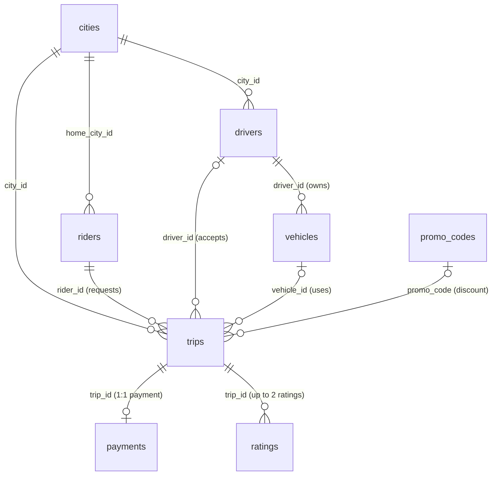

# Phase 2: Schema Design

**Course:** Database Management Systems (B.Tech 2nd Year)  
**Database:** PostgreSQL 15+ · **Schema Name:** `uber`  
**Related Files:** `sql/01_schema.sql` · `sql/02_load_data.sql` · `diagrams/er_diagram.png` · `dbms/01_normalization.md`

---

## 1. Quick Start (How to Run)

Run these commands in your terminal from the project folder:

```bash
# 1. Create a clean database
createdb uber_db

# 2. Create the tables and constraints
psql -d uber_db -f sql/01_schema.sql

# 3. Load the 8 CSV files from seed_data/ and run verification checks
psql -d uber_db -f sql/02_load_data.sql

# 4. Set timezone to IST (Asia/Kolkata) so dates match Indian time (+05:30)
psql -d uber_db -c "ALTER DATABASE uber_db SET timezone TO 'Asia/Kolkata';"
```

---

## 2. Basic Database Terms (Quick Reference)

- **Primary Key (PK):** The column(s) that identify each row uniquely. It can never be empty (NOT NULL) and never repeated.
- **Foreign Key (FK):** A column that points to a primary key in another table (e.g., `trips.rider_id` must be an existing rider).
- **NOT NULL:** The column must always have a value.
- **UNIQUE:** No two rows can have the same value (e.g., phone numbers or license numbers).
- **CHECK:** A simple rule the data must follow (e.g., `stars BETWEEN 1 AND 5`).
- **ON DELETE RESTRICT:** Stops someone from deleting a parent record if child records still point to it (e.g., cannot delete a rider who has past trips).
- **ON DELETE CASCADE:** Automatically deletes child rows when the parent row is deleted (used for ratings when a trip is purged).

---

## 3. Data Dictionary

All 8 tables live inside the `uber` schema.

### Table 1: `cities` (10 rows)
Stores the cities where Uber runs and their base pricing rules.

| Column | Type | Constraints | Why in Plain Words |
|---|---|---|---|
| `city_id` | SMALLINT | PK | Only 10 cities, so a small 2-byte integer is plenty. |
| `city_name` | VARCHAR(50) | NOT NULL, UNIQUE | Cities are searched by name; no two cities share a name. |
| `state` | VARCHAR(50) | NOT NULL | State where the city is located. |
| `base_fare` | NUMERIC(6,2) | NOT NULL, CHECK (>= 0) | Money needs exact decimals (never FLOAT, which has rounding issues). |
| `per_km_rate` | NUMERIC(6,2) | NOT NULL, CHECK (> 0) | Rate charged per km; must be greater than zero. |
| `per_min_rate` | NUMERIC(6,2) | NOT NULL, CHECK (>= 0) | Rate charged per minute of travel. |
| `launched_on` | DATE | NOT NULL | Launch date in that city. |

---

### Table 2: `promo_codes` (40 rows)
Stores discount coupon codes.

| Column | Type | Constraints | Why in Plain Words |
|---|---|---|---|
| `promo_code` | VARCHAR(20) | PK | The code itself (`RIDE001`) is already unique, so it is the key. |
| `discount_pct` | SMALLINT | NOT NULL, CHECK (1–100) | Percentage off (between 1% and 100%). |
| `max_discount` | NUMERIC(8,2) | NOT NULL, CHECK (> 0) | Maximum rupee cap for the discount. |
| `valid_from` | DATE | NOT NULL | Start date of the coupon. |
| `valid_to` | DATE | NOT NULL | Expiry date of the coupon (`valid_to >= valid_from`). |
| `is_active` | BOOLEAN | NOT NULL, DEFAULT TRUE | Simple true/false switch to disable a code. |

---

### Table 3: `riders` (30,000 rows)
Stores customer accounts.

| Column | Type | Constraints | Why in Plain Words |
|---|---|---|---|
| `rider_id` | INT | PK | Unique ID for each rider. |
| `full_name` | VARCHAR(100) | NOT NULL | Rider's name. |
| `email` | VARCHAR(254) | NOT NULL, UNIQUE | Email must be unique per account. |
| `phone` | VARCHAR(10) | NOT NULL, UNIQUE | 10-digit phone number stored as text (we never do math on phone numbers). |
| `home_city_id` | SMALLINT | NOT NULL, FK → cities | Every rider belongs to a home city. |
| `signup_date` | DATE | NOT NULL | Account registration date. |
| `rider_rating` | NUMERIC(2,1) | NULLABLE, CHECK (1.0–5.0) | Rating out of 5.0; empty (NULL) for brand new riders. |
| `is_active` | BOOLEAN | NOT NULL, DEFAULT TRUE | Whether the rider's account is active. |

---

### Table 4: `drivers` (3,000 rows)
Stores driver partners.

| Column | Type | Constraints | Why in Plain Words |
|---|---|---|---|
| `driver_id` | INT | PK | Unique ID for each driver. |
| `full_name` | VARCHAR(100) | NOT NULL | Driver's name. |
| `phone` | VARCHAR(10) | NOT NULL, UNIQUE | Driver's mobile number. |
| `license_no` | VARCHAR(30) | NOT NULL, UNIQUE | One license belongs to one driver. |
| `city_id` | SMALLINT | NOT NULL, FK → cities | Operating city of the driver. |
| `joined_on` | DATE | NOT NULL | Date driver joined Uber. |
| `driver_rating` | NUMERIC(2,1) | NULLABLE, CHECK (1.0–5.0) | Driver's average star rating. |
| `status` | VARCHAR(20) | NOT NULL, CHECK in list | Status can only be `ACTIVE`, `INACTIVE`, or `SUSPENDED`. |

---

### Table 5: `vehicles` (3,300 rows)
Stores vehicles registered by drivers.

| Column | Type | Constraints | Why in Plain Words |
|---|---|---|---|
| `vehicle_id` | INT | PK | Unique vehicle ID. |
| `driver_id` | INT | NOT NULL, FK → drivers | Every vehicle belongs to a driver (some drivers own 2 cars). |
| `registration_no` | VARCHAR(15) | NOT NULL, UNIQUE | License plate number (e.g., `DL01AA0001`). |
| `make` | VARCHAR(30) | NOT NULL | Car brand (Maruti, Hyundai, etc.). |
| `model` | VARCHAR(30) | NOT NULL | Car model (Dzire, i10, etc.). |
| `manufacture_year` | SMALLINT | NOT NULL, CHECK (2000–2030) | Year car was made. |
| `vehicle_type` | VARCHAR(10) | NOT NULL | Category (MINI, SEDAN, AUTO, BIKE). |
| `seat_capacity` | SMALLINT | NOT NULL, CHECK (1–8) | Seating capacity between 1 and 8. |

---

### Table 6: `trips` (300,000 rows)
The main table recording every ride request and trip event.

| Column | Type | Constraints | Why in Plain Words |
|---|---|---|---|
| `trip_id` | BIGINT | PK | BIGINT because trips grow to millions. |
| `rider_id` | INT | NOT NULL, FK → riders | Every trip must have a rider who booked it. |
| `driver_id` | INT | NULLABLE, FK → drivers | Empty (NULL) until a driver accepts the trip. |
| `vehicle_id` | INT | NULLABLE, FK → vehicles | Empty (NULL) until a driver accepts. |
| `city_id` | SMALLINT | NOT NULL, FK → cities | City where the trip happens. |
| `promo_code` | VARCHAR(20) | NULLABLE, FK → promo_codes | Empty (NULL) if no promo code was used. |
| `requested_at` | TIMESTAMPTZ | NOT NULL | Keeps timestamp with Indian time zone (`+05:30`). |
| `pickup_at` | TIMESTAMPTZ | NULLABLE | Recorded when ride starts; empty for requested/cancelled. |
| `dropoff_at` | TIMESTAMPTZ | NULLABLE | Recorded when ride finishes. |
| `pickup_lat, pickup_lng` | NUMERIC(9,6) | NOT NULL | Exact GPS pickup coordinates (6 decimals ≈ 11 cm). |
| `drop_lat, drop_lng` | NUMERIC(9,6) | NOT NULL | Exact GPS dropoff coordinates. |
| `distance_km` | NUMERIC(6,2) | NULLABLE, CHECK (>= 0) | Distance in km; known after trip finishes. |
| `duration_min` | SMALLINT | NULLABLE, CHECK (>= 0) | Duration in minutes; known after trip finishes. |
| `surge_multiplier` | NUMERIC(4,2) | NOT NULL, CHECK (>= 1.0) | Default 1.00; surge pricing never gives a discount. |
| `fare_amount` | NUMERIC(10,2) | NULLABLE, CHECK (>= 0) | Final fare charged; known after trip completes. |
| `status` | VARCHAR(30) | NOT NULL | REQUESTED, ACCEPTED, ONGOING, COMPLETED, CANCELLED... |

---

### Table 7: `payments` (245,839 rows)
Stores payments for completed trips.

| Column | Type | Constraints | Why in Plain Words |
|---|---|---|---|
| `payment_id` | BIGINT | PK | Unique ID for each payment transaction. |
| `trip_id` | BIGINT | NOT NULL, UNIQUE, FK → trips | `UNIQUE` ensures at most 1 payment per trip. |
| `amount` | NUMERIC(10,2) | NOT NULL, CHECK (>= 0) | Paid amount in Rupees. |
| `method` | VARCHAR(20) | NOT NULL, CHECK in list | Must be UPI, CASH, CARD, or WALLET. |
| `payment_status` | VARCHAR(20) | NOT NULL, CHECK in list | Must be SUCCESS, FAILED, PENDING, or REFUNDED. |
| `paid_at` | TIMESTAMPTZ | NOT NULL | Exact time of payment attempt. |

---

### Table 8: `ratings` (307,214 rows)
Stores reviews given after trips.

| Column | Type | Constraints | Why in Plain Words |
|---|---|---|---|
| `trip_id` | BIGINT | NOT NULL, FK → trips | Trip being rated (CASCADE deletes ratings if trip is deleted). |
| `rated_by` | VARCHAR(6) | NOT NULL, CHECK in list | Who gave the rating: `RIDER` or `DRIVER`. |
| `stars` | SMALLINT | NOT NULL, CHECK (1–5) | Rating score between 1 and 5 stars. |
| `comment` | TEXT | NULLABLE | Optional text review. |
| `created_at` | TIMESTAMPTZ | NOT NULL | Time when rating was given. |

*Composite Primary Key:* `PRIMARY KEY (trip_id, rated_by)`. A trip can receive at most 1 rating from the rider and 1 from the driver. Combining both columns forms a natural unique key without needing a fake ID column.

---

## 4. Why Some Columns are Empty (NULL)

A common beginner question: *Why are several columns in `trips` nullable?*  
Because **a trip is created before it finishes!**

- When a rider clicks **Request**: We know the rider, city, and coordinates. We do *not* know the driver, vehicle, or final fare yet.
- When a driver clicks **Accept**: `driver_id` and `vehicle_id` get filled.
- When driver **Picks up**: `pickup_at` is recorded.
- When driver **Drops off**: `dropoff_at`, `distance_km`, `duration_min`, and `fare_amount` are filled, and status becomes `COMPLETED`.
- If a ride is **Cancelled**: It stops early, so dropoff time and fare remain empty.

---

## 5. ER Diagram & Relationships

Visual diagram files:
- [diagrams/er_diagram.png](file:///Users/aastikyadav/Downloads/uber-dbms/diagrams/er_diagram.png)
- [diagrams/er_diagram.pdf](file:///Users/aastikyadav/Downloads/uber-dbms/diagrams/er_diagram.pdf)



- **1 : N (One-to-Many):** One city has many riders, drivers, and trips. One driver can have 1 or 2 registered vehicles.
- **1 : 1 (One-to-One):** Each completed trip has at most one payment record (`UNIQUE(trip_id)`).
- **Composite Key:** Each completed trip can have up to 2 ratings (one by rider, one by driver).

---

## 6. Normalization Summary

> *See [dbms/01_normalization.md](file:///Users/aastikyadav/Downloads/uber-dbms/dbms/01_normalization.md) for the full explanation.*

- **1NF:** Every cell has a single value, and ratings are stored in their own table rather than repeating columns inside `trips`.
- **2NF:** In `ratings (trip_id, rated_by)`, all review attributes depend on the entire pair. All other tables have single-column primary keys.
- **3NF & BCNF:** Driver, rider, vehicle, and city details are stored once in their own tables and linked by foreign keys, removing transitive dependencies.

---

## 7. Seed Data Verification Results

After running `sql/02_load_data.sql`:

1. **Row Counts (All 8 tables matched 100%):**
   - `cities`: 10 rows
   - `promo_codes`: 40 rows
   - `riders`: 30,000 rows
   - `drivers`: 3,000 rows
   - `vehicles`: 3,300 rows
   - `trips`: 300,000 rows
   - `payments`: 245,839 rows
   - `ratings`: 307,214 rows

2. **Integrity Checks (0 bad rows found):**
   - *Check 1 (Driver owns vehicle):* 0 bad rows.
   - *Check 2 (Completed trips have exactly 1 payment):* 0 bad rows.
   - *Check 3 (Payments only for completed trips):* 0 bad rows.

3. **Data Observations Found in Seed Data:**
   - Emails in `riders` have mixed casing (`User.Name@Mail.com`), which will need lower-case index handling in Phase 4 for Problem P3.
   - Trips in `REQUESTED` status have NULL `driver_id`. This explains why Query R10 returned an empty list in Problem P6 (`NOT IN` fails when subquery returns NULL).
